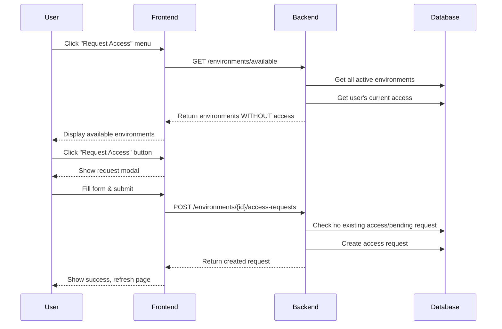
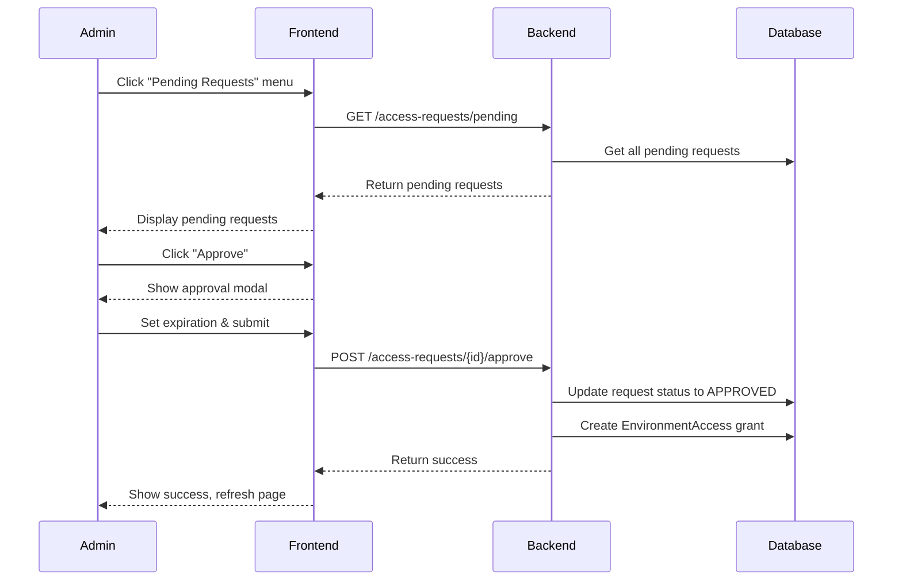

# Feature: Request Environment Access

## Document Info
| Field | Value |
|-------|-------|
| **Feature ID** | FEAT-002 |
| **Created** | 2026-04-07 |
| **Status** | Implemented |
| **Priority** | High |

---

## 1. Overview

### 1.1 Purpose
Allow non-admin users to request access to environments they don't currently have access to. This enables a self-service workflow where users can discover available environments and submit access requests with business justification.

### 1.2 User Story
> As a **regular user**, I want to **request access to environments I don't have access to**, so that I can **get the permissions I need for my work without manually contacting administrators**.

### 1.3 Acceptance Criteria
- [ ] Users can see a list of environments they DON'T have access to
- [ ] Users can submit access requests with access level and business justification
- [ ] Users can view their pending and historical requests
- [ ] Users can cancel pending requests
- [ ] Admins can approve/deny requests from "Pending Requests" page
- [ ] Approved requests automatically grant access to the user
- [ ] Users receive feedback on request status changes

---

## 2. Current State Analysis

### 2.1 What Exists
| Component | Status | Location |
|-----------|--------|----------|
| Access Request Entity | ✅ Complete | `model/EnvironmentAccessRequest.java` |
| Access Request Repository | ✅ Complete | `repository/EnvironmentAccessRequestRepository.java` |
| Access Request Service | ✅ Complete | `service/EnvironmentAccessService.java` |
| Access Request Controller | ✅ Complete | `controller/EnvironmentAccessController.java` |
| Frontend - Request Access Page | ✅ Complete | `js/features/access-requests.js` |
| Frontend - Pending Requests Page | ✅ Complete | `js/features/access-requests.js` |

### 2.2 What's Broken
| Issue | Root Cause | Impact |
|-------|------------|--------|
| Users see environments they already have access to | `fetchAvailableEnvironments()` calls `/api/v1/environments` which returns only accessible environments | Feature is useless for non-admin users |
| No API endpoint for "available" environments | Missing backend endpoint | Frontend can't get correct data |

### 2.3 Architecture Gap
```
Current Flow (Broken):
┌─────────────┐     GET /environments      ┌─────────────┐
│   Frontend  │ ─────────────────────────► │   Backend   │
│ (User View) │                            │             │
└─────────────┘     Returns: environments  └─────────────┘
                    user HAS access to ❌

Required Flow:
┌─────────────┐   GET /environments/available   ┌─────────────┐
│   Frontend  │ ───────────────────────────────►│   Backend   │
│ (User View) │                                 │             │
└─────────────┘   Returns: environments user    └─────────────┘
                  does NOT have access to ✅
```

---

## 3. Solution Design

### 3.1 Backend Changes

#### 3.1.1 EnvironmentService.java
**File:** `src/main/java/com/tcgdigital/vmcontrol/service/EnvironmentService.java`

**Add imports:**
```java
import java.util.Set;
import java.util.stream.Collectors;
```

**Add new method:**
```java
/**
 * Get active environments the current user does NOT have access to.
 * Used for the "Request Access" feature - shows environments users can request access to.
 */
public List<Environment> getEnvironmentsWithoutAccessForCurrentUser() {
    String userId = userService.getCurrentUserId();
    Timestamp now = new Timestamp(System.currentTimeMillis());

    // Get all active environments
    List<Environment> allActive = getAllActiveEnvironments();

    // Get environment IDs user already has access to
    List<EnvironmentAccess> accessList = accessRepository.findActiveAccessByUser(userId, now);
    Set<String> accessedEnvIds = accessList.stream()
            .map(ea -> ea.getEnvironment().getEnvironmentId())
            .collect(Collectors.toSet());

    // Return environments user does NOT have access to
    return allActive.stream()
            .filter(env -> !accessedEnvIds.contains(env.getEnvironmentId()))
            .sorted((a, b) -> a.getName().compareToIgnoreCase(b.getName()))
            .toList();
}
```

#### 3.1.2 EnvironmentController.java
**File:** `src/main/java/com/tcgdigital/vmcontrol/controller/EnvironmentController.java`

**Add new endpoint (before `getEnvironment` method):**
```java
@GetMapping("/available")
@PreAuthorize("isAuthenticated()")
@Operation(
        summary = "List environments available for access request",
        description = "Retrieves active environments the current user does NOT have access to. Used for Request Access feature."
)
@ApiResponses(value = {
        @ApiResponse(
                responseCode = "200",
                description = "Successfully retrieved list of available environments",
                content = @Content(
                        mediaType = "application/json",
                        array = @ArraySchema(schema = @Schema(implementation = EnvironmentDTO.class))
                )
        )
})
public ResponseEntity<List<EnvironmentDTO>> listAvailableEnvironments() {
    List<Environment> environments = environmentService.getEnvironmentsWithoutAccessForCurrentUser();

    List<EnvironmentDTO> dtos = environments.stream()
            .map(env -> EnvironmentDTO.fromEntityWithCounts(
                    env,
                    environmentService.getGroupCount(env.getEnvironmentId()),
                    environmentService.getVmCount(env.getEnvironmentId())
            ))
            .toList();

    return ResponseEntity.ok(dtos);
}
```

### 3.2 Frontend Changes

#### 3.2.1 config.js
**File:** `src/main/resources/static/js/config.js`

**Update environments section:**
```javascript
// Environments
environments: {
    list: `${API_BASE_URL}/environments`,
    available: `${API_BASE_URL}/environments/available`,  // NEW
    get: (id) => `${API_BASE_URL}/environments/${id}`,
    create: `${API_BASE_URL}/environments`,
    update: (id) => `${API_BASE_URL}/environments/${id}`,
    delete: (id) => `${API_BASE_URL}/environments/${id}`
},
```

#### 3.2.2 access-requests.js
**File:** `src/main/resources/static/js/features/access-requests.js`

**Update `fetchAvailableEnvironments` function (line ~67-79):**
```javascript
/**
 * Fetch available environments (ones user doesn't have access to)
 */
function fetchAvailableEnvironments() {
    return new Promise((resolve, reject) => {
        // Use the endpoint that returns environments user doesn't have access to
        ApiClient.get(Config.API.environments.available)
            .done(function(environments) {
                resolve(environments || []);
            })
            .fail(function(xhr) {
                // Fallback: if endpoint doesn't exist, return empty
                if (xhr.status === 404) {
                    console.warn('Available environments endpoint not found');
                    resolve([]);
                } else {
                    reject(xhr);
                }
            });
    });
}
```

---

## 4. API Specification

### 4.1 New Endpoint

#### GET /api/v1/environments/available

**Description:** Returns active environments the authenticated user does NOT have access to.

**Authentication:** Required (any authenticated user)

**Response:**
```json
[
    {
        "environmentId": "uuid-123",
        "name": "production-env",
        "displayName": "Production Environment",
        "description": "Main production environment",
        "isActive": true,
        "groupCount": 3,
        "vmCount": 12,
        "createdAt": "2026-01-15T10:30:00Z"
    }
]
```

**Response Codes:**
| Code | Description |
|------|-------------|
| 200 | Success - returns list (may be empty) |
| 401 | Not authenticated |

### 4.2 Existing Endpoints (Reference)

| Method | Endpoint | Description | Auth |
|--------|----------|-------------|------|
| POST | `/api/v1/environments/{envId}/access-requests` | Create access request | User |
| GET | `/api/v1/access-requests/my` | Get user's requests | User |
| DELETE | `/api/v1/access-requests/{requestId}` | Cancel request | User |
| GET | `/api/v1/access-requests/pending` | List pending (admin) | Admin |
| POST | `/api/v1/access-requests/{requestId}/approve` | Approve request | Admin |
| POST | `/api/v1/access-requests/{requestId}/deny` | Deny request | Admin |

---

## 5. User Interface

### 5.1 Request Access Page (User View)

```
┌─────────────────────────────────────────────────────────────┐
│ 📤 Request Environment Access                               │
│ Request access to environments you need for your work       │
├─────────────────────────────────────────────────────────────┤
│ 🔍 [Search environments...                              ]   │
├─────────────────────────────────────────────────────────────┤
│ 📁 Available Environments                            [12]   │
├─────────────────────────────────────────────────────────────┤
│ Environment              │ Size    │ Action                 │
│─────────────────────────────────────────────────────────────│
│ Production Environment   │ 15 VMs  │ [📤 Request Access]    │
│   Main production env    │         │                        │
│─────────────────────────────────────────────────────────────│
│ Staging Environment      │ 8 VMs   │ [⏳ Request Pending]   │
│   Pre-production testing │         │                        │
│─────────────────────────────────────────────────────────────│
│ Analytics Sandbox        │ 5 VMs   │ [📤 Request Access]    │
│   Data analysis env      │         │                        │
├─────────────────────────────────────────────────────────────┤
│ Showing 1-3 of 12 environments      [◄] [1] [2] [3] [►]     │
└─────────────────────────────────────────────────────────────┘

┌─────────────────────────────────────────────────────────────┐
│ ⏳ My Pending Requests                                 [2]  │
├─────────────────────────────────────────────────────────────┤
│ Environment  │ Status  │ Level │ Requested │ Actions       │
│─────────────────────────────────────────────────────────────│
│ Staging Env  │ PENDING │ USER  │ 2h ago    │ [Cancel]      │
│ Dev Sandbox  │ PENDING │ USER  │ 1d ago    │ [Cancel]      │
└─────────────────────────────────────────────────────────────┘

┌─────────────────────────────────────────────────────────────┐
│ 📜 Request History                                    [▼]   │
└─────────────────────────────────────────────────────────────┘
```

### 5.2 Request Access Modal

```
┌─────────────────────────────────────────────────┐
│ Request Access: Production Environment      [X] │
├─────────────────────────────────────────────────┤
│                                                 │
│ Access Level                                    │
│ ┌─────────────────────────────────────────────┐ │
│ │ User - Can start/stop VMs              [▼] │ │
│ └─────────────────────────────────────────────┘ │
│                                                 │
│ Reason for Request *                            │
│ ┌─────────────────────────────────────────────┐ │
│ │ I need access to deploy the Q2 release     │ │
│ │ for the marketing campaign. My team is     │ │
│ │ responsible for the frontend updates.      │ │
│ └─────────────────────────────────────────────┘ │
│                                                 │
├─────────────────────────────────────────────────┤
│              [Cancel]  [Submit Request]         │
└─────────────────────────────────────────────────┘
```

### 5.3 Pending Requests Page (Admin View)

```
┌─────────────────────────────────────────────────────────────┐
│ ✅ Pending Access Requests                    [3 pending]   │
│ Review and approve user access requests                     │
├─────────────────────────────────────────────────────────────┤
│ Requester       │ Environment │ Level │ When   │ Reason     │ Actions        │
│─────────────────────────────────────────────────────────────────────────────│
│ John Doe        │ Production  │ USER  │ 2h ago │ Q2 release │ [✓] [✗]       │
│ john@company.com│             │       │        │            │               │
│─────────────────────────────────────────────────────────────────────────────│
│ Jane Smith      │ Staging     │ ADMIN │ 1d ago │ Testing    │ [✓] [✗]       │
│ jane@company.com│             │       │        │            │               │
└─────────────────────────────────────────────────────────────┘
```

---

## 6. Complete Workflow

### 6.1 User Flow



### 6.2 Admin Flow



---

## 7. Data Model

### 7.1 EnvironmentAccessRequest Entity

```java
@Entity
@Table(name = "environment_access_request")
public class EnvironmentAccessRequest {
    @Id
    private String requestId;           // UUID

    @ManyToOne
    private Environment environment;    // Target environment

    @ManyToOne
    private User requester;             // User requesting access

    @Enumerated(EnumType.STRING)
    private AccessLevel requestedAccessLevel;  // VIEWER, USER, ADMIN

    private String reason;              // Business justification

    @Enumerated(EnumType.STRING)
    private AccessRequestStatus status; // PENDING, APPROVED, DENIED, CANCELLED

    @ManyToOne
    private User reviewer;              // Admin who processed request

    private String reviewNotes;         // Admin comments

    private Timestamp createdAt;
    private Timestamp processedAt;
}
```

### 7.2 Access Request Status Flow

```
     ┌──────────┐
     │ PENDING  │
     └────┬─────┘
          │
    ┌─────┼─────┐
    │     │     │
    ▼     ▼     ▼
┌────────┐ ┌────────┐ ┌───────────┐
│APPROVED│ │ DENIED │ │ CANCELLED │
└────────┘ └────────┘ └───────────┘
  (Admin)   (Admin)     (User)
```

---

## 8. Security Considerations

### 8.1 Authorization Matrix

| Action | USER | ENV_ADMIN | ADMIN |
|--------|------|-----------|-------|
| View available environments | ✅ | ✅ | ✅ |
| Submit access request | ✅ | ✅ | ✅ |
| View own requests | ✅ | ✅ | ✅ |
| Cancel own pending request | ✅ | ✅ | ✅ |
| View all pending requests | ❌ | ✅ | ✅ |
| Approve/Deny requests | ❌ | ✅ | ✅ |

### 8.2 Validation Rules

1. **Cannot request access if already have access** - Prevents duplicate grants
2. **Cannot request if pending request exists** - Prevents spam
3. **Reason is required** - Ensures business justification
4. **Only requester can cancel** - Ownership protection
5. **Only admins can approve/deny** - Authorization enforcement

---

## 9. Testing Plan

### 9.1 Unit Tests

| Test Case | Component | Expected Result |
|-----------|-----------|-----------------|
| Get environments without access | EnvironmentService | Returns only environments user lacks access to |
| Create request - success | EnvironmentAccessService | Request created with PENDING status |
| Create request - already has access | EnvironmentAccessService | ValidationException thrown |
| Create request - pending exists | EnvironmentAccessService | ValidationException thrown |
| Approve request | EnvironmentAccessService | Request APPROVED, access grant created |
| Deny request | EnvironmentAccessService | Request DENIED, no access grant |

### 9.2 Integration Tests

| Test Case | Description |
|-----------|-------------|
| Full request workflow | User requests → Admin approves → User has access |
| Request cancellation | User requests → User cancels → Request CANCELLED |
| Denial workflow | User requests → Admin denies → No access granted |
| Pagination | List 20+ available environments, verify pagination |

### 9.3 UI Tests

| Test Case | Description |
|-----------|-------------|
| Empty state | User has access to all environments |
| Search filter | Filter environments by name |
| Request modal | Fill form, submit, verify success |
| Pending badge | Verify badge count updates |

---

## 10. Implementation Checklist

### 10.1 Backend
- [x] Add `Set` and `Collectors` imports to `EnvironmentService.java`
- [x] Add `getEnvironmentsWithoutAccessForCurrentUser()` method to `EnvironmentService.java`
- [x] Add `GET /api/v1/environments/available` endpoint to `EnvironmentController.java`
- [ ] Write unit tests for new service method
- [ ] Write integration tests for new endpoint

### 10.2 Frontend
- [x] Add `environments.available` to `config.js`
- [x] Update `fetchAvailableEnvironments()` in `access-requests.js`
- [ ] Test Request Access page with new endpoint
- [ ] Verify pagination and search still work
- [ ] Test full request workflow

### 10.3 Documentation
- [x] Create feature document (this file)
- [ ] Update API documentation
- [ ] Update user guide


